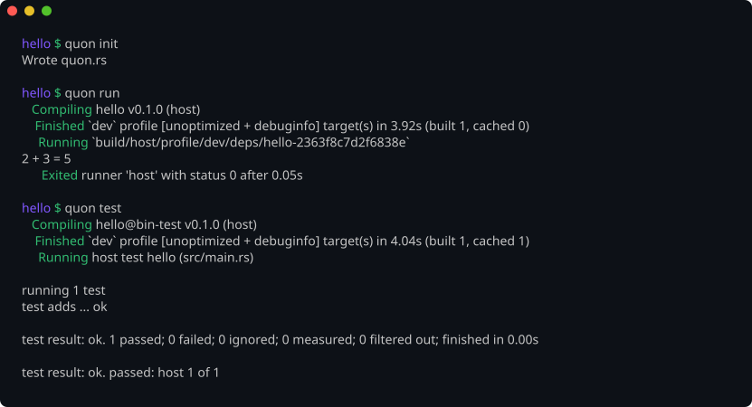

# Quon

Quon is a declarative build system for Rust. It reads your Cargo
workspace, drives `rustc` directly, and handles the parts Cargo leaves
to shell scripts: several targets in one build, custom targets and
sysroots, linker scripts, post-build steps, and runners such as QEMU.
The whole build is described in `quon.rs`, a Rust file that lives next
to your `Cargo.toml`.


<sub>A clean build of [Hadron](https://github.com/asterism-labs/hadron),
an x86_64 kernel: proc macros for the host, a sysroot and the kernel for
`x86_64-unknown-none`, and an ESP with Limine. `quon test` then runs
the host unit tests and boots the kernel in QEMU twice. Played at 2x.</sub>

## Drop it into a Cargo project



`quon init` reads the manifests and writes a `quon.rs`. A project
with no target builds for the host, so `quon run` and `quon test`
work straight away. A kernel workspace gets its target, linker script
and QEMU setup from `.cargo/config.toml`, `rust-toolchain.toml` and
`limine.conf`.

`Cargo.toml` stays the source of truth. Quon reads dependencies,
features, editions, lints and build scripts from the manifests on every
build, and writes to `build/`, so `cargo build` keeps working beside it.

Quon builds itself this way: its [`quon.rs`](quon.rs) is 44 lines,
and `quon test` runs the same tests as `cargo test`.

## Why Quon?

Cargo builds one target per invocation and stops at the compiled
binary. Quon covers what comes before and after:

- **Several targets in one build.** A UEFI bootloader, a kernel and the
  host tools they need build together, each group for its own target.
- **Custom sysroots.** For a target with no prebuilt standard library,
  Quon builds `core`, `alloc` and `compiler_builtins` from source with
  the flags you choose, without `-Zbuild-std`.
- **Steps after compiling.** Linker scripts, file copies, image tools
  and EFI System Partition layout are declared next to the crates they
  use.
- **Runners.** `quon run` and `quon test` start the binary on the
  host, through any command, or under QEMU with UEFI, direct-kernel or
  BIOS boot.
- **Typed config options.** Kconfig-style booleans, numbers, strings
  and choices, with dependencies, ranges and presets, become `cfg`
  flags and a generated config crate.

The output looks like Cargo's: `Compiling`, a progress bar for the
crates in flight, and `Finished` with the profile and cache counts.

## Quick start

**Requirements:**

- Rust 1.99 or later. Stable works, except for custom `.json` targets,
  which need nightly.
- The `rust-src` component, for targets Quon builds a sysroot for.
- QEMU, only for a QEMU runner.

**Install:**

```sh
cargo install --git https://github.com/hxyulin/quon.git quon
```

**Generate `quon.rs`:**

```sh
cd my-project            # the directory with the root Cargo.toml
quon init               # a host build, or a kernel build if a target is set
quon init --target x86_64-unknown-none --bootloader limine --limine 11.4.1
```

`quon init` leaves a `// TODO:` comment for each setting it cannot
find. See [Generating quon.rs](docs/src/getting-started/init.md).

**Build and run:**

```sh
quon build              # compile everything
quon build -r           # with the release profile
quon run -- <args>      # build, then start the run binary through its runner
quon test               # host unit tests, tests/, doctests, QEMU tests
quon check              # metadata-only check pass
quon configure          # write rust-project.json for rust-analyzer
```

## A kernel `quon.rs`

```rust
use quon_config::{Config, Result};

pub fn config(cfg: &mut Config) -> Result<()> {
    cfg.project("my-kernel", "0.1.0");
    let target = cfg.target("x86_64-unknown-none");
    cfg.cargo_workspace(".");

    cfg.profile("dev")
        .runner("qemu")
        .target(target)
        .opt_level(0)
        .debug_info(true)
        .run_binary("kernel");

    cfg.group("kernel")
        .target(target)
        .package("kernel")
        .linker_script("crates/kernel/kernel.ld");

    cfg.runner("qemu")
        .qemu("qemu-system-x86_64")
        .machine("q35")
        .memory(128)
        .cores(1)
        .serial_stdio();

    Ok(())
}
```

See [the quon.rs guide](docs/src/configuration/quon-rs.md) for the
full API, including how to
[split config across files](docs/src/configuration/quon-rs.md#splitting-config-across-files).

## Features

- **Direct `rustc` invocation**: per-crate flag assembly from the Cargo
  manifests
- **Host and cross profiles**: `profile.target_host()` for tools,
  declared or `.json` targets for everything else
- **Custom sysroot compilation**: `core`, `alloc` and
  `compiler_builtins` built for your target
- **Kconfig-style options**: typed options with defaults, ranges,
  dependencies and presets
- **Configuration overrides**: `quon.rs` defaults, a `.quon-config`
  file and `QUON_*` environment variables
- **Build cache**: mtime and SHA-256 freshness checks, rebuilt when the
  toolchain changes
- **Parallel scheduler**: a dependency graph run by a worker pool
- **Dependency vendoring**: `quon vendor` with a lockfile and
  fingerprints
- **Runners**: the host, a command, or QEMU with OVMF, a GDB server and
  timeouts
- **Testing**: unit tests, `tests/`, doctests, QEMU integration tests
  and boot tests from one `quon test`
- **rust-analyzer integration**: `quon configure` writes
  `rust-project.json`
- **Pipelines and rules**: build stages with copy, mkimage and exec
  rules
- **ESP assembly**: EFI System Partition layout for UEFI boot
- **External plugins**: `quon foo` runs `quon-foo` from `$PATH`, and
  a runner named `.plugin("x")` asks `quon-runner-x` for its command

## Documentation

The full documentation is in [`docs/`](docs/), built with
[mdbook](https://rust-lang.github.io/mdBook/):

```sh
cd docs && mdbook serve
```

## License

Quon is licensed under either of

- [Apache License, Version 2.0](LICENSE-APACHE)
- [MIT license](LICENSE-MIT)

at your option.
